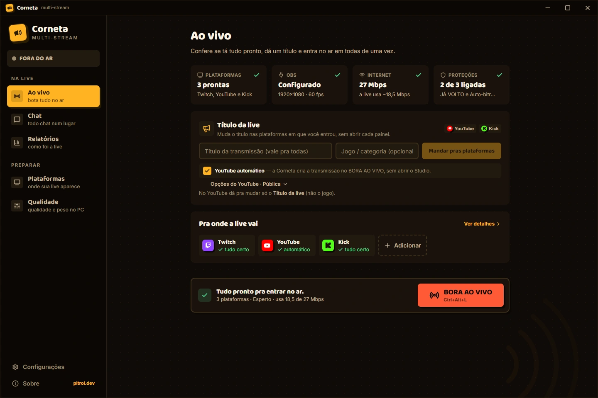
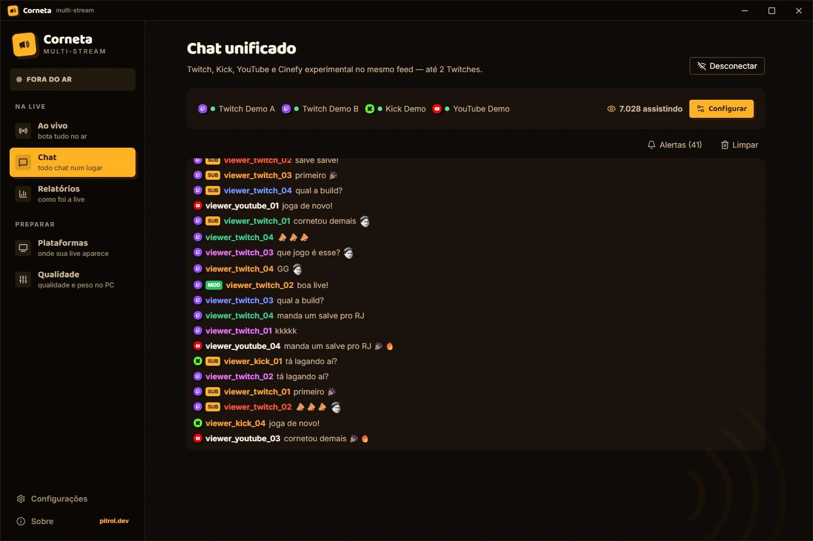
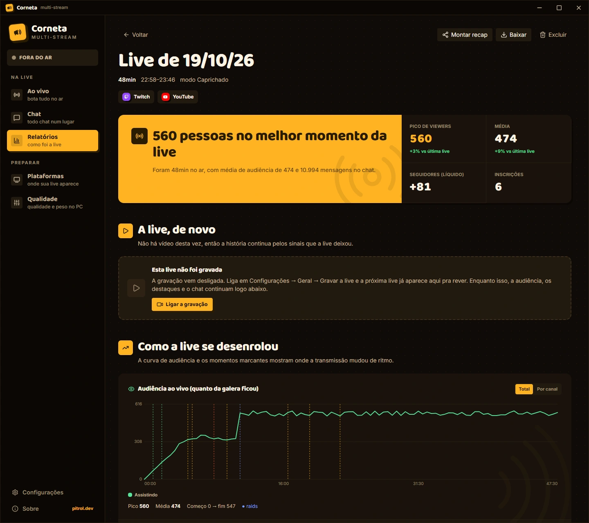

<p align="center">
  
</p>

<a name="corneta"></a>
<h1 align="center">Corneta</h1>

<p align="center">
  <strong>Your stream, from the first signal to the last replay.</strong><br>
  Stream from OBS to several platforms, bring the chat together and relive the best moments.<br>
  An app on your PC, open source.
</p>

<p align="center">
  <a href="#meet-corneta">Meet it</a> ·
  <a href="#try-it-without-rust-obs-or-accounts">Try it</a> ·
  <a href="#develop-and-contribute">Contribute</a> ·
  <a href="#documentation">Documentation</a>
</p>

> **Windows x64 · Open source.** [Try the demo](#try-it-without-rust-obs-or-accounts) or see [how to use it on your stream](#use-it-on-your-stream).

[](docs/images/readme/live.webp)

_The real interface in demo mode, with made-up data. Click the screenshots to enlarge them._

## Meet Corneta

You keep building your scenes in OBS. Corneta receives that signal on your computer and sends it to the destinations you choose, while keeping the conversation and the story of the stream close at hand.

**Video goes from your PC to the platforms.** The Corneta website helps with setup and with signing in to integrations; it does not receive or relay your stream.

### Before the stream: prepare each destination

Add platforms by URL and stream key, connect accounts where an integration is available, and check OBS and your upload before going on air. Custom destinations have a place too.

Choose how the signal reaches each platform:

| Mode            | What it does                                                                               |
| --------------- | ------------------------------------------------------------------------------------------ |
| **Straight up** | Passes the OBS signal through without re-encoding the video.                               |
| **Smart**       | Passes the signal through where it is compatible and adapts the destinations that need it. |
| **All out**     | Re-encodes at the quality chosen for each destination.                                     |

When available, GPU acceleration helps with processing. Each destination uses upload bandwidth; adapting the video also takes computer resources. Corneta shows estimates before the stream — actual capacity depends on your connection, machine and settings.

### During the stream: the conversation stays close

Follow **Twitch, YouTube and Kick** chat in a single interface, with platform identification, emotes and moderation options depending on the integration. Chat and alerts can also open in separate windows.

[](docs/images/readme/chat.webp)

_A simulated conversation, with sources identified by platform._

The live panel tracks the state of each destination and the available OBS metrics. Per-destination reconnection, optional local recording and moment markers help you look after the stream without losing the thread of the conversation.

> Streaming, sign-in and chat are separate capabilities. Sending video to a platform does not guarantee OAuth, chat, sending messages or moderation there. See the [integration matrix](docs/NETWORK-SURFACE.md#the-three-capabilities-are-independent).

### After the stream: a story to revisit

The report starts with your stream: duration, available audience data, chat participation and marked moments. Charts show how it evolved; technical details get a chapter of their own, for when you want to dig in.

[](docs/images/readme/report.webp)

_A 48-minute demo report, with made-up data and no video recording._

**Recorded it?** Rewatch the local video alongside the saved chat and jump between moments. **Didn't record?** The report still works with the data that was saved, without depending on a video. You can also export it to look at later.

Video and chat history are optional and off by default. Turn on what you want to keep before the stream; the replay depends on those files still being available on disk.

## Try it without Rust, OBS or accounts

The shortest way to get to know the interface and start contributing is the **browser demo**. It uses made-up data and does not require connecting any account.

With **Node.js 24.18.1** and **pnpm 11.18.0** installed:

```sh
git clone https://github.com/pitroldev/corneta.git
cd corneta
pnpm install --frozen-lockfile
pnpm contrib:demo
```

Open **http://127.0.0.1:1420**. Explore stream setup, chat and the sample reports from the side menu.

The contributor profile does not load your personal `.env` and turns telemetry off. Do not copy real credentials or settings to try it out. The demo simulates streaming: it does not validate OBS, the encoder, the vault or real sign-in.

## Use it on your stream

See the [project releases](https://github.com/pitroldev/corneta/releases) for installers and release notes. **Windows x64 is the current platform**; macOS, Linux and Windows ARM do not have a validated distribution yet. Contributor builds are meant for development and do not replace the release installers.

To test the native app from source, follow the [desktop development](#native-desktop--windows-x64) path below. Run your tests outside a real stream.

## Develop and contribute

The desktop interface uses **React, TypeScript and Tailwind CSS**; the native app, **Tauri 2 and Rust**. The website and the setup API live in the **Next.js** workspace in `web/`.

You don't need to set up the whole project to help. Start with the area you want to improve and the [contribution guide](CONTRIBUTING.md). Documentation, reproducible reports and interface tweaks count too.

### Validate a contribution

In a clean clone, without `.env`, accounts or personal files:

```sh
pnpm contrib:check
```

This command validates the app and the website without the official operation's secrets. Additional requirements and native tests are in the [development guide](docs/DEVELOPMENT.md).

### Website and local API — Next.js

```sh
pnpm contrib:web
```

Open **http://localhost:7390**. You can work on the website without configuring OAuth; signing in to real accounts requires configuring the providers.

The profile refuses real `web/.env*` files. If you already have a configured operation, use a clean clone — do not move or delete your credentials. For self-hosting and OAuth, see [configuration](docs/CONFIGURATION.md) and [network contracts](docs/NETWORK-SURFACE.md).

### Native desktop — Windows x64

<details>
<summary><strong>Requirements and commands to run the native app</strong></summary>

Besides Node/pnpm, install **Rust 1.97.1**, **Visual Studio Build Tools with C++/MSVC and the Windows SDK**, **PowerShell 7** (`pwsh`) and the **WebView2 Runtime**. OBS with obs-websocket v5 is required to test the OBS integration.

```powershell
pwsh -NoProfile -File scripts/fetch-binaries.ps1
pnpm contrib:app:dev
```

The script downloads and verifies the pinned versions of FFmpeg and MediaMTX. The first build compiles the Rust dependencies and is heavier than the demo; the time, memory and disk space it needs vary with the machine and cache.

To compile only the local executable, without creating or installing a distribution package:

```sh
pnpm contrib:app:build
```

The profile uses a separate contributor identity and vault, with the updater and telemetry turned off. **OBS and network ports are still shared:** do not test during a real stream. You do not need the official updater private key.

See [development](docs/DEVELOPMENT.md) for the profile's limits. Packaging and distribution follow the [release gates](docs/RELEASE-GATES.md) and [signing](docs/SIGNING.md), not the contribution flow.

</details>

### Where things live

| Directory                    | Responsibility                                                        |
| ---------------------------- | --------------------------------------------------------------------- |
| [`src/`](src/)               | Desktop interface, design system, chat, reports and simulated engine. |
| [`src-tauri/`](src-tauri/)   | Native engine, OBS, media processing, vault and local persistence.    |
| [`web/`](web/)               | Website, content and setup/OAuth API. It does not relay video.        |
| [`scripts/`](scripts/)       | Development, validation and release preparation tools.                |
| [`docs/`](docs/README.md)    | The project's maintained guides and contracts.                        |
| [`compliance/`](compliance/) | Compliance inventories and evidence for the distribution.             |

The media flow is **local MediaMTX → Rust/FFmpeg processing → destinations**, with per-destination supervision. Copying, re-encoding and shared processing depend on the mode and on compatibility. See the [architecture](docs/ARCHITECTURE.md) for details.

**Code, comments and documentation are in English.** Issues can be opened in English or Portuguese. Before larger changes, start a conversation in an issue; for bugs, include reproduction steps with made-up data. Follow the [code of conduct](CODE_OF_CONDUCT.md).

## Documentation

| I want to…                               | Where to start                                                                                                           |
| ---------------------------------------- | ------------------------------------------------------------------------------------------------------------------------ |
| Understand what works and what changed   | [Compatibility](docs/COMPATIBILITY.md) · [Release notes](https://github.com/pitroldev/corneta/releases)                  |
| Set up the environment and find tasks    | [Development](docs/DEVELOPMENT.md) · [Contributing](CONTRIBUTING.md)                                                     |
| Understand the code and test scenarios   | [Architecture](docs/ARCHITECTURE.md) · [Performance](docs/PERFORMANCE.md) · [Report fixtures](docs/SYNTHETIC-REPORTS.md) |
| Configure integrations or a distribution | [Configuration](docs/CONFIGURATION.md) · [Release gates](docs/RELEASE-GATES.md)                                          |
| Get help or report a vulnerability       | [Support](SUPPORT.md) · [Security channel](SECURITY.md)                                                                  |

The [full index](docs/README.md) lists the other guides, including design, content, privacy and operations.

## Privacy and security

Credentials use the native vault; recordings and reports stay on the computer. The screenshots in this README were taken in a disposable profile, with made-up data only — [provenance and review of the images](docs/PUBLIC-ASSETS.md#readme-screenshots).

In the official distribution with telemetry configured, **usage data is only sent after you explicitly turn it on; error reports are on when no earlier choice exists and can be turned off**. The controls are independent and earlier choices are preserved. Turning on usage data does not send events from before it was turned on. Contributor builds disable sending. See the [privacy policy](https://www.corneta.live/legal/privacy) for what is collected and the [configuration](docs/CONFIGURATION.md) for variables and kill switches.

Never post stream keys, tokens, `.env`, personal reports or raw logs in issues. Suspected vulnerabilities must go through the [private security channel](SECURITY.md).

## License

Corneta's own code is [MIT](LICENSE). Dependencies, fonts, icons, models and sidecars keep their own licenses and notices: see [THIRD_PARTY_NOTICES.md](THIRD_PARTY_NOTICES.md). Distributing FFmpeg also requires meeting the obligations of the binary used.

Forks are welcome, but must not present themselves as the official distribution or reuse its keys and services without their own configuration.

---

[Try Corneta](#try-it-without-rust-obs-or-accounts) · [Contribute to the project](CONTRIBUTING.md) · [Back to top](#corneta)
